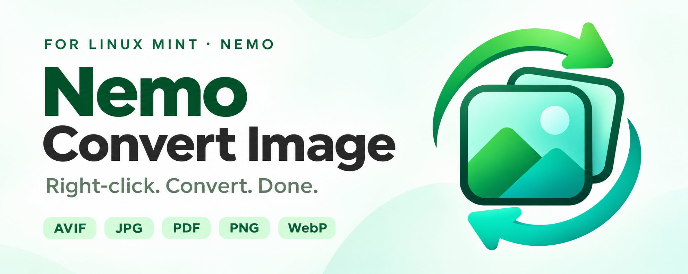

<h1 align="center">
  
</h1>

<p align="center"><strong>Ubah format gambar langsung dari menu klik kanan.</strong></p>

<p align="center">Pilih gambar. Tentukan format. Hasil langsung tersimpan.</p>

<p align="center">
  <a href="https://raw.githubusercontent.com/endyardhie/Convert-Image/main/install-image.sh"><strong>Linux</strong></a> ·
  <a href="https://github.com/endyardhie/Convert-Image/releases/tag/v3.0.0-beta.1"><strong>Windows — Pratinjau</strong></a> ·
  <a href="#cara-memasang">Panduan pemasangan</a> ·
  <a href="#cara-menggunakan">Cara menggunakan</a> ·
  <a href="#pertanyaan-umum">Pertanyaan umum</a>
</p>

---

**Convert Image** membantu Anda menyiapkan foto untuk dibagikan, mengubah gambar untuk website, atau menyimpan gambar sebagai PDF. Pilih versi untuk **Linux dengan Nemo** atau **Windows dengan File Explorer**, lalu gunakan langsung dari menu klik kanan.

Tidak perlu mengunggah gambar ke layanan online atau membuka aplikasi editor. Anda bisa memilih satu gambar maupun banyak gambar sekaligus. **File asli tetap tersimpan; hasil konversi dibuat sebagai file baru.**

| Gambar yang bisa dibuka | Pilihan hasil |
| --- | --- |
| JPG/JPEG, PNG, WebP, AVIF | AVIF, JPG, PDF, PNG, WebP |

## Cara memasang

| Sistem yang Anda gunakan | Pilih installer |
| --- | --- |
| **Linux Mint Cinnamon, Ubuntu, atau Debian dengan Nemo** | [install-image.sh](https://raw.githubusercontent.com/endyardhie/Convert-Image/main/install-image.sh) |
| **Windows 10/11 x64 — versi pratinjau** | [Windows Setup.exe](https://github.com/endyardhie/Convert-Image/releases/tag/v3.0.0-beta.1) |

### Linux

Ditujukan terutama untuk **Linux Mint 22.x Cinnamon**. Ubuntu dan Debian memerlukan pengelola file **Nemo**; menu ini belum terintegrasi dengan Nautilus atau Dolphin. Koneksi internet diperlukan saat pemasangan untuk mengunduh perlengkapan aplikasi yang belum tersedia.

1. **[Unduh installer](https://raw.githubusercontent.com/endyardhie/Convert-Image/main/install-image.sh)** dan simpan dengan nama `install-image.sh`. Jika browser menampilkan isi script, simpan halaman tersebut sebagai file dengan nama yang sama.
2. Buka folder tempat Anda menyimpannya, lalu pilih **Buka di Terminal / Open in Terminal** dari menu klik kanan pada area kosong folder.
3. Salin dan jalankan perintah berikut:

   ```bash
   bash install-image.sh
   ```

4. Ikuti petunjuk di terminal sampai selesai. Jika diminta, masukkan password akun Linux Anda untuk memasang paket yang diperlukan. **Jalankan installer sebagai pengguna biasa, tanpa menambahkan `sudo` di depan perintah.**
5. Selesaikan aktivitas salin/pindah file yang sedang berjalan, lalu mulai ulang Nemo:

   ```bash
   nemo -q
   ```

6. Buka kembali pengelola file. Menu **Convert Image** siap digunakan saat Anda memilih gambar yang didukung.

### Windows

1. Buka **[halaman unduhan Windows](https://github.com/endyardhie/Convert-Image/releases/tag/v3.0.0-beta.1)**, lalu unduh file **`Convert-Image-3.0.0-Windows-x64-Setup.exe`** pada bagian **Assets**.
2. Buka installer, lalu ikuti langkah pemasangan sampai selesai. Aplikasi dipasang untuk akun Windows Anda; **Python dan komponen konversi sudah disertakan**.
3. Pilih gambar di File Explorer, lalu klik kanan → **Convert Image**.
4. Pada **Windows 11**, buka **Show more options / Tampilkan opsi lainnya** terlebih dahulu jika menu belum terlihat. Anda juga bisa membuka **Convert Image** dari menu **Start** untuk memilih beberapa gambar sekaligus.

Versi Windows merupakan **rilis pratinjau** untuk komputer x64. Pengujian otomatis mencakup konversi, menu, pemasangan, pembaruan, dan penghapusan. Pemilik proyek juga sudah mencoba aplikasi di Windows dan melaporkan semua berjalan normal. Installer saat ini belum ditandatangani secara digital, sehingga Windows dapat menampilkan pemberitahuan penerbit tidak dikenal. Build ini belum ditujukan untuk Windows ARM64 atau 32-bit.

## Cara menggunakan

1. **Pilih gambar.** Buka folder gambar, lalu pilih satu atau beberapa file. Gunakan `Ctrl` sambil mengeklik untuk memilih beberapa gambar.
2. **Klik kanan → Convert Image.** Pilih format hasil: **Avif**, **Jpg**, **Pdf**, **Png**, atau **Webp**.
3. **Pilih kualitas.** Gunakan **High Quality**, **Standard**, atau **Small Size** sesuai kebutuhan.
4. **Tunggu sampai selesai.** Jendela proses menampilkan gambar yang sedang dikerjakan. Setelah selesai, Anda akan melihat ringkasan hasilnya.

> **Mulai dari sini:** untuk penggunaan sehari-hari, coba **Jpg → Standard**. Untuk gambar website yang perlu latar transparan, coba **Webp → Standard**.

## Pilih format yang sesuai

| Format | Cocok untuk | Yang perlu diketahui |
| --- | --- | --- |
| **Avif** | Gambar website atau foto saat ingin mencoba kompresi yang lebih hemat | Prosesnya dapat lebih lama. Pastikan aplikasi atau website tujuan mendukung AVIF. |
| **Jpg** | Foto untuk dibagikan atau digunakan di aplikasi yang menerima JPG | Area transparan akan menjadi putih. |
| **Pdf** | Mengirim gambar sebagai dokumen | Satu gambar menjadi satu PDF satu halaman. Beberapa gambar menghasilkan beberapa PDF terpisah. |
| **Png** | Logo, ilustrasi, atau gambar yang membutuhkan latar transparan | Ukuran file bisa lebih besar daripada format lain. |
| **Webp** | Foto dan gambar website, termasuk gambar berlatar transparan | Pastikan aplikasi atau website tujuan menerima WebP. |

Anda juga dapat memilih **format yang sama dengan file asal**, misalnya JPG → JPG atau PNG → PNG, untuk mencoba ukuran dan pengaturan hasil yang berbeda.

## Pilih kualitasnya

| Pilihan | Gunakan ketika… | Ukuran gambar |
| --- | --- | --- |
| **High Quality** | Detail gambar lebih penting daripada ukuran file | Mempertahankan resolusi asli. |
| **Standard** | Anda menginginkan pilihan seimbang untuk pemakaian sehari-hari | Sisi terpanjang maksimal **1920 piksel**. |
| **Small Size** | Anda membutuhkan gambar beresolusi lebih kecil untuk dibagikan atau diunggah | Sisi terpanjang maksimal **1280 piksel**. |

Rasio gambar tetap dijaga, gambar tidak dipotong, dan gambar kecil tidak diperbesar. Untuk PNG, Standard dan Small Size terutama berbeda pada ukuran resolusinya.

**Hasil tidak selalu lebih kecil daripada file asal.** Ukurannya bergantung pada isi gambar, format, dan kualitas yang dipilih. High Quality juga tidak dapat mengembalikan detail yang sudah buram atau hilang pada gambar asal. JPG dan gambar di dalam PDF tetap memakai kompresi yang dapat mengurangi detail, termasuk pada High Quality.

## Menemukan hasil konversi

Hasil tersimpan **di folder yang sama dengan gambar asal**, dengan nama yang menunjukkan kualitas pilihan Anda:

```text
liburan.jpg                 ← gambar asli
liburan-standard.webp       ← hasil Webp, kualitas Standard
liburan-small.jpg           ← hasil Jpg, kualitas Small Size
liburan-high.pdf            ← hasil Pdf, kualitas High Quality
```

Jika nama hasil sudah dipakai, aplikasi menambahkan nomor, misalnya `liburan-standard-1.webp`. File sebelumnya tetap aman.

Anda bisa membatalkan proses dari jendela konversi. Hasil yang sudah selesai tetap tersimpan. Pada beberapa format, pembatalan baru diterapkan setelah gambar yang sedang dikerjakan selesai diproses, sehingga mungkin tidak langsung berhenti.

## Memperbarui atau menghapus aplikasi

### Memperbarui

Unduh kembali **[installer terbaru](https://raw.githubusercontent.com/endyardhie/Convert-Image/main/install-image.sh)**, lalu ulangi langkah pemasangan. Pengaturan Anda tetap dipertahankan. Mulai ulang Nemo setelah selesai.

Untuk Windows, unduh installer versi berikutnya dari **[Releases](https://github.com/endyardhie/Convert-Image/releases)**, tutup aplikasi konversi, lalu jalankan installer tersebut. Pengaturan Anda tetap tersimpan.

### Menghapus

**Linux:** buka terminal di folder installer, lalu jalankan:

```bash
bash install-image.sh --uninstall
```

Mulai ulang Nemo sesudahnya. Menu dan aplikasi konversi akan dihapus; gambar asli, hasil konversi, pengaturan, log, serta cadangan tetap tersimpan.

**Windows:** buka **Settings → Apps → Installed apps → Convert Image → Uninstall**. Gambar asli, hasil konversi, pengaturan, dan log tetap tersimpan. Jika Windows meminta penutupan File Explorer untuk memperbarui atau menghapus ekstensi, selesaikan dahulu aktivitas salin/pindah file Anda.

## Pertanyaan umum

<details>
<summary><strong>Menu Convert Image belum muncul. Apa yang harus saya lakukan?</strong></summary>

Pilih gambar JPG/JPEG, PNG, WebP, atau AVIF. Jika pilihan berisi folder atau jenis file lain, menu tidak ditampilkan.

**Linux:** gunakan pengelola file **Nemo**. Jalankan `nemo -q`, lalu buka kembali Nemo. Jika masih belum muncul, periksa **Edit → Plugins** dan aktifkan ekstensi yang terkait.

**Windows:** coba **Show more options** pada Windows 11. Jika menu belum tampil setelah pemasangan, tutup dan buka kembali File Explorer. Anda tetap dapat memakai aplikasi dari menu **Start → Convert Image**. Jalankan kembali installer jika perlu memperbaiki pemasangan.

</details>

<details>
<summary><strong>Mengapa konversi AVIF terasa lama?</strong></summary>

Pengaturan bawaan AVIF mengutamakan kompresi, sehingga foto besar bisa membutuhkan waktu beberapa menit atau lebih. Periksa nama file pada jendela proses dan tunggu sampai selesai. Pilih JPG atau WebP jika format tersebut juga sesuai dengan kebutuhan Anda.

</details>

<details>
<summary><strong>Apakah latar transparan akan tetap transparan?</strong></summary>

Ya, pada hasil **AVIF, PNG, dan WebP**. Pada hasil **JPG dan PDF**, area transparan akan menjadi putih.

</details>

<details>
<summary><strong>Bisakah beberapa foto digabung menjadi satu PDF?</strong></summary>

Belum. Setiap gambar menghasilkan PDF tersendiri. Isi PDF berupa gambar; tulisan pada foto tidak diubah menjadi teks yang dapat dipilih atau diedit.

</details>

<details>
<summary><strong>Mengapa ada gambar yang gagal atau dilewati?</strong></summary>

Aplikasi ini mendukung **gambar diam**. Gambar animasi dan dokumen PDF tidak dapat dijadikan file asal. Pastikan gambar bisa dibuka dan foldernya bisa menyimpan file baru. Gambar tertentu dengan kedalaman warna tinggi atau model warna khusus dapat dilewati pada High Quality; coba Standard atau Small Size. Jika tetap gagal, lihat alasan dan lokasi log pada ringkasan hasil.

</details>

<details>
<summary><strong>Pemasangan berhenti dengan pesan error. Bagaimana melanjutkannya?</strong></summary>

Periksa koneksi internet dan pesan di terminal. Jangan lanjutkan memakai aplikasi jika pemasangan belum selesai. Installer dapat dijalankan kembali setelah penyebab error diperbaiki. Petunjuk pemeriksaan paket dan pemasangan alternatif tersedia di [panduan teknis](docs/advanced.md).

</details>

---

**Untuk pengguna lanjutan:** pengaturan kualitas, penggunaan melalui terminal, pemecahan masalah, dan petunjuk pengembangan tersedia di **[panduan teknis](docs/advanced.md)**. Riwayat pembaruan dapat dibaca di **[Changelog](CHANGELOG.md)**.

## Lisensi

Gratis digunakan dan dimodifikasi sesuai **[MIT License](LICENSE)**, termasuk untuk kebutuhan komersial, dengan menyertakan pemberitahuan hak cipta dan lisensi.

## Code signing policy

Kami sedang menyiapkan pengajuan penandatanganan gratis melalui **SignPath Foundation**. Unduhan Windows saat ini masih **belum ditandatangani**. Informasi penerbit, proses rilis, dan privasi tersedia pada **[Code signing policy](CODE_SIGNING.md)**.
